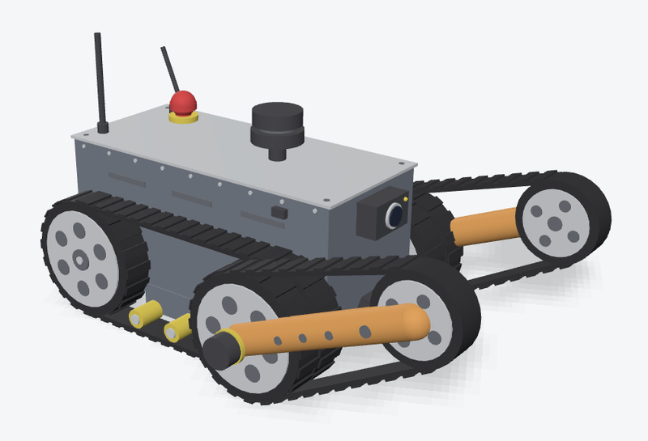
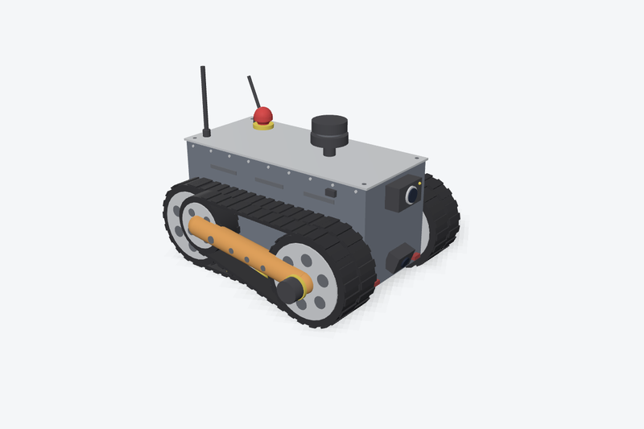
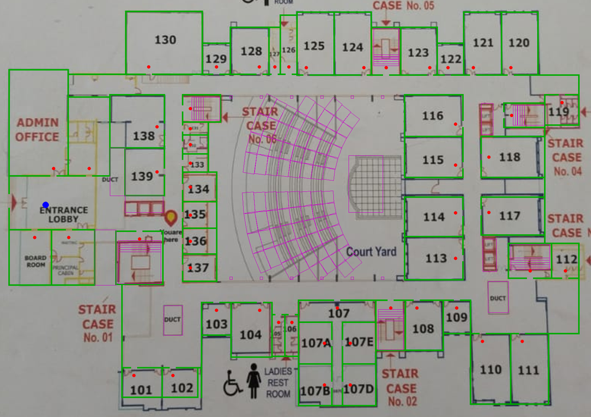
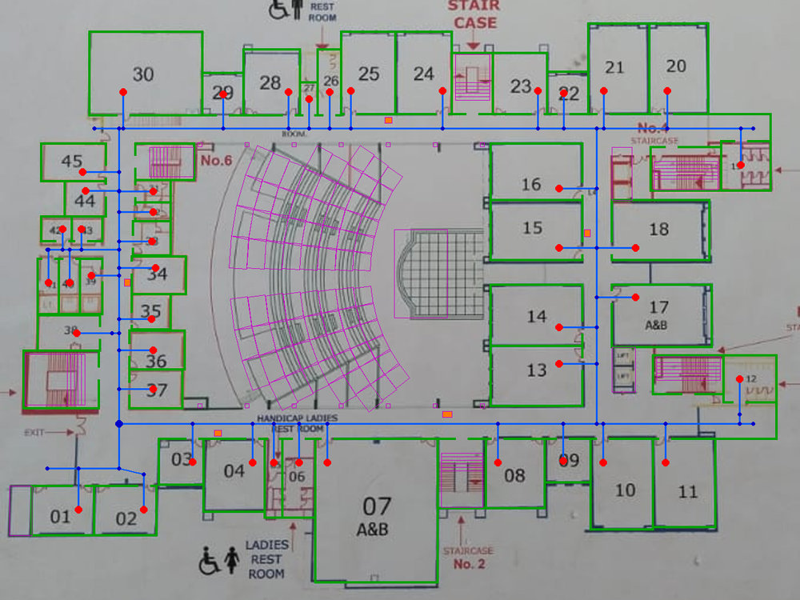
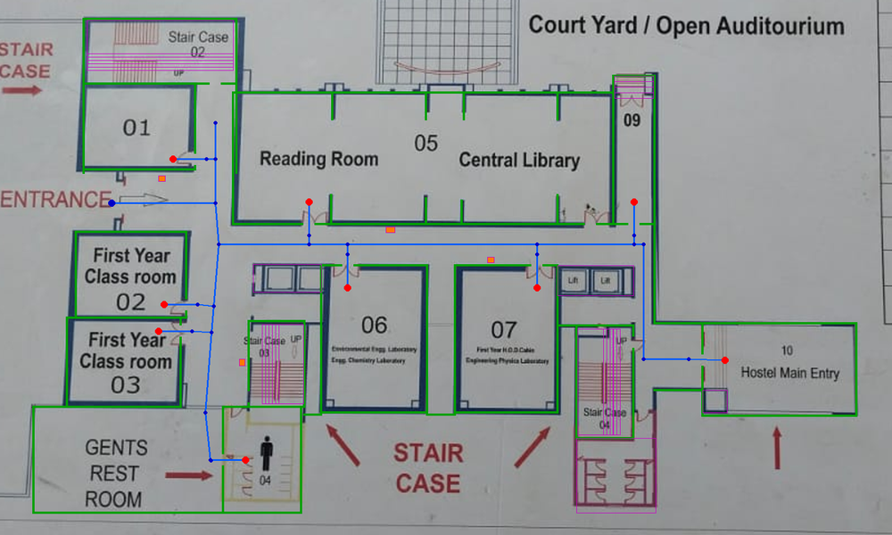

# PathSense: Stair-Climbing Indoor Service Robot

A ROS 2 simulation of **PathSense**, a tracked indoor service robot with two retractable climbing arms.
In the simulation it maps a building floor live with SLAM and drives to any room number you type,
following a planned route of nodes and edges while avoiding obstacles. The worlds are built from the
real floor plans of Bharati Vidyapeeth's College of Engineering, Lavale, Pune.

Final-year B.E. Computer Engineering project by **Akash Akhade**.

<p align="center">
  
  
</p>
<p align="center"><i>Left: climbing arms forward (stair pose). Right: arms folded for driving.</i></p>

## Features

- **Robot model (URDF / xacro):** 508 × 393 × 249 mm tracked base, two revolute tracked climbing arms,
  2D LiDAR, front camera, downward stair camera, IMU, barometer, 6 time-of-flight edge sensors.
  Built from primitive shapes only, so no mesh files are needed.
- **Gazebo Harmonic simulation:** skid-steer drive, position-controlled arms, simulated sensors bridged to ROS 2.
- **Three college floors:** the lower ground, ground and first floor, generated from the floor-plan photos.
  They include doors, stairwells, lifts, the courtyard amphitheatre, and test obstacles in the corridors.
- **Route-graph navigation:** each floor has a topological graph (corridor junctions, doors, one node per room).
  Type a room number and the shortest route is planned with Dijkstra, or use `tour` to visit every room
  in an optimised order (nearest neighbour + 2-opt).
- **Live SLAM + Nav2:** SLAM Toolbox builds the map while the robot drives, and Nav2 (NavFn planner, Regulated
  Pure Pursuit controller) follows the route. A custom behaviour tree backs up and replans when the robot is blocked.
- **RViz visualisation:** live map, route graph, planned path, LiDAR, camera feeds and the full-colour robot model.
- **Phone remote:** a web page served over Wi-Fi (rosbridge + web_video_server) with a joystick, a STOP button,
  room selection, arm controls and a live camera view. `twist_mux` gives the phone priority over automation.

## Worlds

| Floor | World file | Route graph | Rooms |
|---|---|---|---|
| Lower ground floor | `college_lower_ground_floor.sdf` | `college_lower_ground_graph.yaml` | 9 |
| Ground floor | `college_ground_floor.sdf` | `college_ground_graph.yaml` | 45 |
| First floor | `college_first_floor.sdf` | `college_graph.yaml` | 43 |
| Stair test | `stair_test.sdf` | (none) | (none) |

<p align="center">
  
  
  
</p>
<p align="center"><i>Generated walls (green), route graph (blue), room goals (red) and test obstacles (orange),
drawn over the original plans. Left to right: first, ground and lower ground floor.</i></p>

## Requirements

- Ubuntu 24.04, ROS 2 Jazzy, Gazebo Harmonic

```bash
sudo apt update
sudo apt install ros-jazzy-ros-gz ros-jazzy-xacro ros-jazzy-robot-state-publisher \
  ros-jazzy-joint-state-publisher-gui ros-jazzy-teleop-twist-keyboard ros-jazzy-rviz2 \
  ros-jazzy-navigation2 ros-jazzy-nav2-bringup ros-jazzy-slam-toolbox ros-jazzy-twist-mux \
  ros-jazzy-rosbridge-suite ros-jazzy-web-video-server
```

## Build

```bash
git clone https://github.com/akashakhade/pathsense_ws.git ~/pathsense_ws
cd ~/pathsense_ws
source /opt/ros/jazzy/setup.bash
colcon build --symlink-install
source install/setup.bash
```

## Run

### Look at the robot in RViz
```bash
ros2 launch pathsense_description display.launch.py
```

### Drive it in Gazebo with the keyboard
```bash
ros2 launch pathsense_description gazebo.launch.py use_tof:=false
ros2 run teleop_twist_keyboard teleop_twist_keyboard     # second terminal (drive)
ros2 run pathsense_description arm_teleop_keyboard.py     # third terminal (arms)
```
While `slam_nav.launch.py` is running, keyboard commands go through `twist_mux`, so start the keyboard teleop with
`--ros-args -r cmd_vel:=cmd_vel_key` instead:
```bash
ros2 run teleop_twist_keyboard teleop_twist_keyboard --ros-args -r cmd_vel:=cmd_vel_key
```

### Room-to-room navigation on a college floor (3 terminals)
Example for the ground floor:
```bash
# 1. Gazebo with the floor
ros2 launch pathsense_description gazebo.launch.py rviz:=false use_tof:=false \
  world:=$HOME/pathsense_ws/install/pathsense_description/share/pathsense_description/worlds/college_ground_floor.sdf

# 2. SLAM Toolbox + Nav2 + twist_mux + RViz
ros2 launch pathsense_description slam_nav.launch.py

# 3. Route-graph navigator
ros2 run pathsense_description graph_navigator.py \
  --graph $HOME/pathsense_ws/install/pathsense_description/share/pathsense_description/config/college_ground_graph.yaml
```
When terminal 3 prints `Nav2 is ready for use!`, type a room number (for example `17`), `tour` to visit every room,
`lobby` to return to the start point, or `list` to show all rooms.
For the first floor, leave out `--graph`. For the lower ground floor, use the `college_lower_ground_*` files.

### Phone remote (4th terminal)
```bash
ros2 launch pathsense_description phone_remote.launch.py
```
Connect the phone to the same Wi-Fi or hotspot as the laptop, then open the address that is printed
(`http://<laptop-ip>:8000`).

## How it works

```
 room number ──► graph_navigator.py ──► Dijkstra on the floor's route graph ──► list of waypoints
                                                                                     │
                       SLAM Toolbox (live map) ──► Nav2: NavFn planner + RPP controller
                                                                                     │
 phone joystick ─► /cmd_vel_phone ─┐                                                 ▼
 keyboard ───────► /cmd_vel_key ───┼─► twist_mux ─► /cmd_vel ─► Gazebo ◄─ /cmd_vel_nav
                                   └── (priority: phone > keyboard > Nav2)
```

## Package layout

```
src/pathsense_description/
├── urdf/      robot model (pathsense.urdf.xacro, macros, materials, Gazebo plugins)
├── worlds/    Gazebo worlds (3 college floors + stair test)
├── config/    route graphs, Nav2 / SLAM / twist_mux parameters, bridge, behaviour tree
├── launch/    display, gazebo, slam_nav, phone_remote
├── scripts/   graph_navigator, arm teleop, phone server, URDF colour helper
├── rviz/      RViz configurations
└── web/       phone remote web page
```

## Notes

- The floor plans have no scale bar, so room sizes use an estimated 0.1 m per plan pixel.
- On a slower laptop, keep `use_tof:=false` and close the RViz camera panels so the simulation runs faster.
